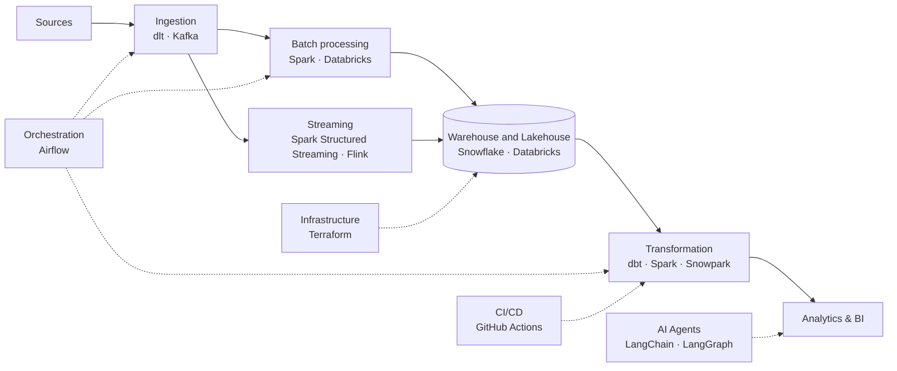

<div align="center">

# Data Engineering vs Analytics Engineering Guide

**A hands-on path from SQL interview patterns to production-style data pipelines, built with Snowflake, Databricks, dbt, Spark, Airflow and more.**


</div>

---

## ✨ Highlights

- **Every SQL pattern solved in five tools:** SQL, pandas, PySpark, Snowpark and dbt, on identical datasets.
- **Interview-style practice sets** (easy, medium, hard) with stress-test data and trap checklists.
- **Production pipeline patterns:** incremental loads, snapshots (SCD Type 2) and safe backfilling.
- **Batch and streaming:** Spark transformations, Spark Structured Streaming, Kafka and Flink.
- **Lakehouse and warehouse:** Databricks (Delta Lake) alongside Snowflake.
- **Engineering practice:** orchestration with Airflow, infrastructure as code with Terraform, CI/CD with GitHub Actions.
- **AI agents** (LangChain, LangGraph) built on top of the data stack.

## 📖 About

This repository documents my learning path across the modern data stack. It has three goals:

1. **Master the SQL interview patterns** (deduplication, running totals, MoM/YoY growth, hierarchies, cohorts) and solve each one in five tools.
2. **Practise the patterns real pipelines depend on:** incremental loads, snapshots and slowly changing dimensions, backfilling, and streaming.
3. **Understand where Data Engineering ends and Analytics Engineering begins**, by building the same ideas at pipeline scale with orchestration, infrastructure as code, CI/CD and AI agents.

Every topic follows the same loop: **learn the concept, solve a practice question, then reproduce it in another framework** to see what changes and what stays the same.

## 🧭 Data Engineering vs Analytics Engineering

| | **Data Engineering** | **Analytics Engineering** |
|---|---|---|
| **Core question** | How does data get here, reliably and at scale? | How do we turn raw data into trusted, usable models? |
| **Typical work** | Ingestion, pipelines, streaming, orchestration, infrastructure | Transformation, modelling, testing, documentation, metrics |
| **Typical tools** | Airflow, Kafka, Flink, Spark, Databricks, dlt, Terraform | dbt, Snowflake / warehouse SQL, BI tools |
| **Main language** | Python, SQL, sometimes Scala/Java | SQL, Jinja, some Python |
| **Output** | Data landed, moved and available | Clean, tested, documented tables for analysts |

The two roles overlap heavily, which is why this repo covers both.



## 🗺️ Roadmap

<!-- EDIT: update the status of each row as you progress -->

| Area | Topic | Focus | Status |
|---|---|---|---|
| **Foundations** | SQL interview patterns | Window functions, dedup, growth, hierarchies, cohorts | 🚧 In progress |
| | pandas | The same patterns in a DataFrame API | 🚧 In progress |
| | Data modelling | Star schema, facts and dimensions | 📅 Planned |
| **Warehouse and Lakehouse** | Snowflake + Snowpark | Warehouse SQL and Python pushed down to Snowflake | 🚧 In progress |
| | Databricks | Lakehouse, Delta Lake, SQL warehouses, medallion architecture | 📅 Planned |
| **Transformation** | dbt | Models, tests, seeds, snapshots, incremental builds | 🚧 In progress |
| | Apache Spark (PySpark) | Batch transformation, joins and window functions at scale | 🚧 In progress |
| **Pipeline patterns** | Incremental loads | `MERGE` / upserts, watermarks, idempotency | 📅 Planned |
| | Snapshots and SCD | Type 1, 2 and 3 slowly changing dimensions | 📅 Planned |
| | Backfilling | Reprocessing history safely | 📅 Planned |
| **Orchestration and ingestion** | Airflow | Orchestrating pipelines and dependencies | 📅 Planned |
| | dlt | Declarative ingestion into the warehouse | 📅 Planned |
| **Streaming** | Kafka | Event streaming fundamentals | 📅 Planned |
| | Spark Structured Streaming | Windows, watermarks, checkpoints | 📅 Planned |
| | Flink | Stateful stream processing | 📅 Planned |
| **Platform and ops** | Terraform | Infrastructure as code for the warehouse and cloud | 📅 Planned |
| | GitHub Actions | CI/CD: lint, test and build on every pull request | 📅 Planned |
| **AI** | AI agents | LangChain and LangGraph on top of the data stack | 📅 Planned |

✅ Done · 🚧 In progress · 📅 Planned

## 📁 Repository Structure

<!-- EDIT: replace with your real tree. Generate it with:  tree /F /A  (PowerShell) -->

```text
.
├── .github/
│   └── workflows/          # CI/CD with GitHub Actions
├── practice_data.py        # Shared datasets used by every framework
├── pandas_tutorial/        # SQL patterns in pandas
├── apache_spark/           # SQL patterns in PySpark, plus Structured Streaming
├── snowpark_tutorial/      # SQL patterns in Snowpark
├── my_dbt_tutorial/        # dbt project (models, seeds, snapshots, tests)
├── .gitignore
└── README.md
```

Folders for Databricks, Terraform, Airflow, dlt, Kafka, Flink and the AI agents will be added as each topic is covered.

## 🎯 SQL Interview Patterns Covered

Each pattern has a concept note, a practice set (easy, medium, hard), stress-test data with deliberate traps, and a worked solution.

| # | Pattern | Key ideas |
|---|---|---|
| 1 | **Deduplication** | `ROW_NUMBER()`, `DISTINCT ON`, `QUALIFY`, tiebreakers, `NULL` keys |
| 2 | **Running totals** | `SUM() OVER`, `ROWS` vs `RANGE` frames, running balance, moving averages |
| 3 | **MoM / YoY growth** | `LAG()`, `NULLIF`, gap filling, self-join on shifted dates, streaks |
| 4 | **Hierarchies** | Recursive CTEs, org charts, category trees |
| 5 | **Cohort analysis** | Retention triangles, LTV |
| 6 | **Ranking** | `RANK` vs `DENSE_RANK` vs `ROW_NUMBER`, top-N per group |

<!-- EDIT: add the remaining patterns as you complete them (target: 12-15) -->

### The same problem in every tool

| SQL concept | PostgreSQL / Snowflake | pandas | PySpark / Snowpark |
|---|---|---|---|
| Number rows per group | `ROW_NUMBER() OVER (PARTITION BY ...)` | `groupby().cumcount()` | `F.row_number().over(w)` |
| Previous row | `LAG(x) OVER (...)` | `groupby()["x"].shift(1)` | `F.lag("x").over(w)` |
| Running total | `SUM(x) OVER (... ROWS ...)` | `groupby()["x"].cumsum()` | `F.sum("x").over(w.rowsBetween(...))` |
| Keep latest per key | `QUALIFY ROW_NUMBER() = 1` (Snowflake) | `drop_duplicates(keep="first")` | `row_number() == 1` filter |

## 🏗️ Data Engineering Patterns

The patterns that separate a query from a pipeline.

### 1. Incremental loads

Process only new or changed rows instead of rebuilding everything.

| Tool | How |
|---|---|
| **dbt** | `incremental` materialization with a `unique_key` |
| **Snowflake** | `MERGE`, or Streams and Tasks |
| **Spark / Databricks** | Delta `MERGE INTO`, Auto Loader |

```sql
-- models/fct_orders.sql (dbt)
{{ config(materialized='incremental', unique_key='order_id') }}

select * from {{ ref('stg_orders') }}

where updated_at > (select max(updated_at) from {{ this }})

```

Key ideas: a **watermark** column, **idempotency** (running twice gives the same result), and handling **late-arriving data**.

### 2. Snapshots and slowly changing dimensions (SCD)

Keep history when a source row changes.

| Type | Behaviour | Use when |
|---|---|---|
| **Type 1** | Overwrite the old value | History does not matter |
| **Type 2** | Add a new row with `valid_from`, `valid_to` and a current flag | You need full history |
| **Type 3** | Keep the previous value in an extra column | You only need one prior value |

```sql
-- snapshots/customers_snapshot.sql (dbt)

{{ config(
    target_schema='snapshots',
    unique_key='customer_id',
    strategy='timestamp',
    updated_at='updated_at'
) }}
select * from {{ source('crm', 'customers') }}

```

dbt adds `dbt_valid_from` and `dbt_valid_to` columns, which is SCD Type 2 out of the box.

### 3. Backfilling

Reprocess historical data without breaking production.

- Make every job **idempotent** and **parameterised by date range**.
- Process history in **windows** (day, week or month), not all at once.
- Test on a **small slice** first and compare row counts and totals.
- Never overwrite production tables until the rebuilt data is validated.

```bash
# dbt: rebuild one model for a date window
dbt run --select fct_orders --vars '{start_date: 2024-01-01, end_date: 2024-01-31}'

# dbt: rebuild an incremental model from scratch
dbt run --select fct_orders --full-refresh
```

In Airflow, the same idea appears as `catchup` and backfill runs over past schedule intervals.

### 4. Spark Structured Streaming

Treat a stream as an unbounded table and use the same DataFrame API.

```python
from pyspark.sql import functions as F

orders = (spark.readStream.format("kafka")
          .option("kafka.bootstrap.servers", "localhost:9092")
          .option("subscribe", "orders")
          .load()
          .select(F.from_json(F.col("value").cast("string"), schema).alias("o"))  # schema defined elsewhere
          .select("o.*"))

(orders
    .withWatermark("event_time", "10 minutes")
    .groupBy(F.window("event_time", "5 minutes"))
    .agg(F.sum("amount").alias("revenue"))
    .writeStream
    .outputMode("append")
    .option("checkpointLocation", "checkpoints/orders_5min")
    .format("delta")                      # Delta Lake, available on Databricks
    .start("tables/orders_5min"))
```

Key ideas: **watermarks** (how late data may arrive), **windows**, **triggers**, **output modes**, and **checkpoints** for fault tolerance.

### 5. CI/CD with GitHub Actions

Every pull request is linted, tested and built before it reaches `main`.

```yaml
# .github/workflows/ci.yml
name: CI

on:
  pull_request:
  push:
    branches: [main]

jobs:
  checks:
    runs-on: ubuntu-latest
    steps:
      - uses: actions/checkout@v4
      - uses: actions/setup-python@v5
        with:
          python-version: "3.12"
      - run: pip install -r requirements.txt
      - run: ruff check .
      - name: dbt build
        working-directory: my_dbt_tutorial
        env:
          SNOWFLAKE_ACCOUNT: ${{ secrets.SNOWFLAKE_ACCOUNT }}
          SNOWFLAKE_USER: ${{ secrets.SNOWFLAKE_USER }}
          SNOWFLAKE_PASSWORD: ${{ secrets.SNOWFLAKE_PASSWORD }}
        run: dbt build --profiles-dir ci
```

<!-- EDIT: the dbt step expects ci/profiles.yml that only reads env_var(...) values and holds no secrets.
     Because profiles.yml is git-ignored, add the line  !ci/profiles.yml  to .gitignore so it can be committed. -->

Credentials live in **GitHub Secrets** (Settings → Secrets and variables → Actions), never in the repo. Optional extras: SQLFluff for SQL style (use the dbt templater for dbt models) and `pytest` for Python logic.

## 🚀 Getting Started

### Prerequisites

- Python 3.11 or 3.12 <!-- EDIT: match your version -->
- Java 17 or 21 (for PySpark)
- A Snowflake account (a free trial is enough)
- A Databricks workspace (the free edition is enough), for the Databricks sections
- Git

### Setup

```bash
git clone https://github.com/OlawoyeTaofeek/DataEngineering-Vs-AnalyticalEngineeringGuide.git
cd DataEngineering-Vs-AnalyticalEngineeringGuide

# Create the environment
python -m venv .venv
.venv\Scripts\activate          # Windows
# source .venv/bin/activate     # macOS / Linux

pip install -r requirements.txt  # EDIT: or `uv sync` if you use uv
```

### Credentials

**No secrets are committed to this repo.** Copy the example file and fill in your own values:

```bash
cp .env.example .env
```

```ini
# .env  (never commit this file)
SNOWFLAKE_ACCOUNT=<orgname>-<account_name>
SNOWFLAKE_USER=<your_user>
SNOWFLAKE_PASSWORD=<your_password>

DATABRICKS_HOST=<https://your-workspace.cloud.databricks.com>
DATABRICKS_TOKEN=<your_personal_access_token>
```

dbt reads its connection from `~/.dbt/profiles.yml` by default. Keep that file outside the repo, or read values with `{{ env_var('...') }}`.

### Using the shared practice data

`practice_data.py` sits at the repo root so every framework loads **identical datasets**. From a notebook inside a sub-folder:

```python
import sys
from pathlib import Path

sys.path.append(str(Path.cwd().parent))

from practice_data import TABLES, typed_rows, EXPECTED_COUNTS
```

Each tutorial folder then loads the data into its own engine (pandas DataFrame, Spark DataFrame, Snowflake table) and checks the row counts.

## 🛠️ Tech Stack

| Category | Tools |
|---|---|
| **Languages** | SQL, Python |
| **Warehouses and engines** | PostgreSQL, Snowflake, Databricks, Apache Spark |
| **Storage format** | Delta Lake |
| **Transformation** | dbt, Snowpark, pandas, Apache Spark |
| **Orchestration** | Apache Airflow |
| **Ingestion and streaming** | dlt, Apache Kafka, Apache Flink, Spark Structured Streaming |
| **Infrastructure** | Terraform |
| **CI/CD** | GitHub Actions |
| **AI** | LangChain, LangGraph |

## 🧠 Skills Demonstrated

- Advanced SQL: window functions, recursive CTEs, gap filling, cohort and growth analysis
- Data quality thinking: stress-test datasets, tiebreakers, `NULL` handling, expected-output checks
- Building the same logic across SQL, pandas, PySpark, Snowpark and dbt
- Pipeline design: incremental loads, SCD Type 2, idempotent backfills
- Batch and streaming processing with Spark, Kafka and Flink
- Infrastructure as code, orchestration and CI/CD
- Secure handling of credentials in a public repository

## 🔒 Security Notes

- Secrets, `profiles.yml`, `.env`, private keys and Terraform state are listed in `.gitignore`.
- CI reads credentials from **GitHub Secrets**, not from files.
- GitHub push protection is enabled, so a blocked push usually means a credential slipped into a commit.
- Rotate any credential that was ever committed, even if you removed it later.

## 🧩 How to Study This Repo

1. Read the **concept note** for a pattern.
2. Attempt the **practice questions** in PostgreSQL or Snowflake SQL first.
3. Check your answer against the **expected output** and the **trap checklist**.
4. Redo it in **pandas**, then **PySpark** or **Snowpark**.
5. For dbt, turn the solution into a **model** and add a **test**.
6. For pipeline patterns, make it **incremental**, then **backfill** a date range and confirm the totals match.

## 🤝 Feedback

Spotted a mistake or have a better solution? Open an issue or a pull request. Corrections to the practice data and expected outputs are especially welcome.

## 📄 License

<!-- EDIT: choose a license, e.g. MIT, and add a LICENSE file -->
Distributed under the MIT License. See `LICENSE` for details.

## 👤 Author

**Olawoye Taofeek**

- GitHub: [@OlawoyeTaofeek](https://github.com/OlawoyeTaofeek)
- LinkedIn: [@OlawoyeTaofeek](https://www.linkedin.com/in/olawoye-taofeek-a7862021a/) <!-- EDIT: your LinkedIn URL -->
- twitter: ...

---

<div align="center">

⭐ If this repo helps you, consider giving it a star.

</div>