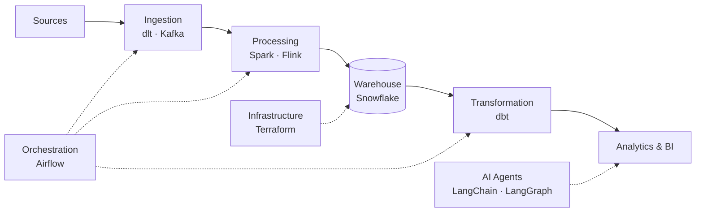

<div align="center">

# Data Engineering vs Analytics Engineering Guide

**A hands-on path from SQL interview patterns to production-style data pipelines, built with Snowflake, dbt, Spark, Airflow and more.**


</div>

---

## 📖 About

This repository documents my learning path across the modern data stack. It has two goals:

1. **Master the SQL interview patterns** (deduplication, running totals, MoM/YoY growth, hierarchies, cohorts) and solve each one in **five tools**: SQL, pandas, PySpark, Snowpark and dbt.
2. **Understand where Data Engineering ends and Analytics Engineering begins**, by building the same ideas at pipeline scale with orchestration, infrastructure-as-code, streaming and AI agents.

Every topic follows the same loop: **learn the concept, solve a practice question, then reproduce it in another framework** to see what changes and what stays the same.

## 🧭 Data Engineering vs Analytics Engineering

| | **Data Engineering** | **Analytics Engineering** |
|---|---|---|
| **Core question** | How does data get here, reliably and at scale? | How do we turn raw data into trusted, usable models? |
| **Typical work** | Ingestion, pipelines, streaming, orchestration, infrastructure | Transformation, modelling, testing, documentation, metrics |
| **Typical tools** | Airflow, Kafka, Flink, Spark, dlt, Terraform | dbt, Snowflake / warehouse SQL, BI tools |
| **Main language** | Python, SQL, sometimes Scala/Java | SQL, Jinja, some Python |
| **Output** | Data landed, moved and available | Clean, tested, documented tables for analysts |

The two roles overlap heavily, which is why this repo covers both.



## 🗺️ Roadmap

<!-- EDIT: update the status of each row as you progress -->

| Topic | Focus | Status |
|---|---|---|
| **SQL interview patterns** | Window functions, dedup, growth, hierarchies, cohorts | 🚧 In progress |
| **pandas** | The same patterns in a DataFrame API | 🚧 In progress |
| **Apache Spark (PySpark)** | Distributed DataFrames and window functions | 🚧 In progress |
| **Snowflake + Snowpark** | Warehouse SQL and Python pushed down to Snowflake | 🚧 In progress |
| **dbt** | Models, tests, seeds, snapshots, incremental builds | 🚧 In progress |
| **Terraform** | Infrastructure as code for the warehouse and cloud | 📅 Planned |
| **Airflow** | Orchestrating pipelines and dependencies | 📅 Planned |
| **dlt** | Declarative ingestion into the warehouse | 📅 Planned |
| **Kafka** | Event streaming fundamentals | 📅 Planned |
| **Flink** | Stateful stream processing | 📅 Planned |
| **AI agents** | LangChain and LangGraph on top of the data stack | 📅 Planned |

✅ Done · 🚧 In progress · 📅 Planned

## 📁 Repository Structure

<!-- EDIT: replace with your real tree. Generate it with:  tree /F /A  (PowerShell) -->

```text
.
├── practice_data.py        # Shared datasets used by every framework
├── pandas_tutorial/        # SQL patterns in pandas
├── apache_spark/           # SQL patterns in PySpark
├── snowpark_tutorial/      # SQL patterns in Snowpark
├── my_dbt_tutorial/        # dbt project (models, seeds, tests)
├── .gitignore
└── README.md
```

Folders for Terraform, Airflow, dlt, Kafka, Flink and the AI agents will be added as each topic is covered.

## 🎯 SQL Interview Patterns Covered

Each pattern has a concept note, a practice set (easy, medium, hard), stress-test data with deliberate traps, and a worked solution.

| # | Pattern | Key ideas |
|---|---|---|
| 1 | **Deduplication** | `ROW_NUMBER()`, `DISTINCT ON`, `QUALIFY`, tiebreakers, `NULL` keys |
| 2 | **Running totals** | `SUM() OVER`, `ROWS` vs `RANGE` frames, running balance, moving averages |
| 3 | **MoM / YoY growth** | `LAG()`, `NULLIF`, gap filling, self-join on shifted dates, streaks |
| 4 | **Hierarchies** | Recursive CTEs, org charts, category trees |
| 5 | **Cohort analysis** | Retention triangles, LTV |
| 6 | **Ranking** | `RANK` vs `DENSE_RANK` vs `ROW_NUMBER`, top-N per group |

<!-- EDIT: add the remaining patterns as you complete them (target: 12-15) -->

### The same problem in every tool

| SQL concept | PostgreSQL / Snowflake | pandas | PySpark / Snowpark |
|---|---|---|---|
| Number rows per group | `ROW_NUMBER() OVER (PARTITION BY ...)` | `groupby().cumcount()` | `F.row_number().over(w)` |
| Previous row | `LAG(x) OVER (...)` | `groupby()["x"].shift(1)` | `F.lag("x").over(w)` |
| Running total | `SUM(x) OVER (... ROWS ...)` | `groupby()["x"].cumsum()` | `F.sum("x").over(w.rowsBetween(...))` |
| Keep latest per key | `QUALIFY ROW_NUMBER() = 1` (Snowflake) | `drop_duplicates(keep="first")` | `row_number() == 1` filter |

## 🚀 Getting Started

### Prerequisites

- Python 3.11 or 3.12 <!-- EDIT: match your version -->
- Java 17 or 21 (for PySpark)
- A Snowflake account (a free trial is enough)
- Git

### Setup

```bash
git clone https://github.com/OlawoyeTaofeek/DataEngineering-Vs-AnalyticalEngineeringGuide.git
cd DataEngineering-Vs-AnalyticalEngineeringGuide

# Create the environment
python -m venv .venv
.venv\Scripts\activate          # Windows
# source .venv/bin/activate     # macOS / Linux

pip install -r requirements.txt  # EDIT: or `uv sync` if you use uv
```

### Credentials

**No secrets are committed to this repo.** Copy the example file and fill in your own values:

```bash
cp .env.example .env
```

```ini
# .env  (never commit this file)
SNOWFLAKE_ACCOUNT=<orgname>-<account_name>
SNOWFLAKE_USER=<your_user>
SNOWFLAKE_PASSWORD=<your_password>
```

dbt reads its connection from `~/.dbt/profiles.yml` by default. Keep that file outside the repo, or read values with `{{ env_var('...') }}`.

### Using the shared practice data

`practice_data.py` sits at the repo root so every framework loads **identical datasets**. From a notebook inside a sub-folder:

```python
import sys
from pathlib import Path

sys.path.append(str(Path.cwd().parent))

from practice_data import TABLES, typed_rows, EXPECTED_COUNTS
```

Each tutorial folder then loads the data into its own engine (pandas DataFrame, Spark DataFrame, Snowflake table) and checks the row counts.

## 🛠️ Tech Stack

| Category | Tools |
|---|---|
| **Languages** | SQL, Python |
| **Warehouses and engines** | PostgreSQL, Snowflake, Apache Spark |
| **Transformation** | dbt, Snowpark, pandas |
| **Orchestration** | Apache Airflow |
| **Ingestion and streaming** | dlt, Apache Kafka, Apache Flink |
| **Infrastructure** | Terraform |
| **AI** | LangChain, LangGraph |

## 🔒 Security Notes

- Secrets, `profiles.yml`, `.env`, private keys and Terraform state are listed in `.gitignore`.
- GitHub push protection is enabled, so a blocked push usually means a credential slipped into a commit.
- Rotate any credential that was ever committed, even if you removed it later.

## 🧩 How to Study This Repo

1. Read the **concept note** for a pattern.
2. Attempt the **practice questions** in PostgreSQL or Snowflake SQL first.
3. Check your answer against the **expected output** and the **trap checklist**.
4. Redo it in **pandas**, then **PySpark** or **Snowpark**.
5. For dbt, turn the solution into a **model** and add a **test**.

## 🤝 Feedback

Spotted a mistake or have a better solution? Open an issue or a pull request. Corrections to the practice data and expected outputs are especially welcome.

## 📄 License

<!-- EDIT: choose a license, e.g. MIT, and add a LICENSE file -->
Distributed under the MIT License. See `LICENSE` for details.

## 👤 Author

**[Your Name]**

- GitHub: [@OlawoyeTaofeek](https://github.com/OlawoyeTaofeek)
- LinkedIn: <!-- EDIT: your LinkedIn URL -->

---

<div align="center">

⭐ If this repo helps you, consider giving it a star.

</div>