# Terraform Advanced: Dependencies, Outputs, State, Lifecycle, Modules

Builds on the basics README. Same two harmless providers, **no cloud account needed**:

| Provider | Resource | Role in examples |
|---|---|---|
| `hashicorp/random` | `random_pet` | Produces a value other resources depend on |
| `hashicorp/local` | `local_file` | Creates a file so you can *see* the effect |

---

## Table of Contents

1. [Resource dependencies](#1-resource-dependencies)
2. [Output variables](#2-output-variables)
3. [Terraform state (deep dive)](#3-terraform-state-deep-dive)
4. [Remote state and locking](#4-remote-state-and-locking)
5. [Lifecycle rules](#5-lifecycle-rules)
6. [Expressions: conditionals, loops, functions](#6-expressions-conditionals-loops-functions)
7. [Modules](#7-modules)
8. [Workspaces](#8-workspaces)
9. [Provisioners and `terraform_data`](#9-provisioners-and-terraform_data)
10. [Debugging and useful tools](#10-debugging-and-useful-tools)
11. [Best practices](#11-best-practices)
12. [Cheat sheet](#12-cheat-sheet)

---

## 1. Resource dependencies

Terraform must know **what to create first**. There are two kinds of dependencies.

| Type | Created by | Who decides |
|---|---|---|
| **Implicit** | A **reference** to another resource's attribute | Terraform (automatic) |
| **Explicit** | `depends_on` | You |

### Implicit (preferred)

```hcl
resource "random_pet" "my_pet" {
  length = 2
}

resource "local_file" "pet_file" {
  filename = "${path.module}/pets.txt"
  content  = "My pet is ${random_pet.my_pet.id}"   # reference = dependency
}
```

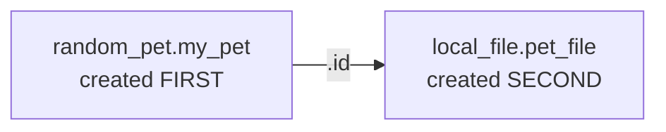

### Explicit (`depends_on`)

Use only when there is **no reference** but order still matters (side effects, permissions, scripts).

```hcl
resource "local_file" "config" {
  filename = "${path.module}/config.txt"
  content  = "ready"
}

resource "random_pet" "my_pet" {
  length     = 2
  depends_on = [local_file.config]     # wait for the file first
}
```

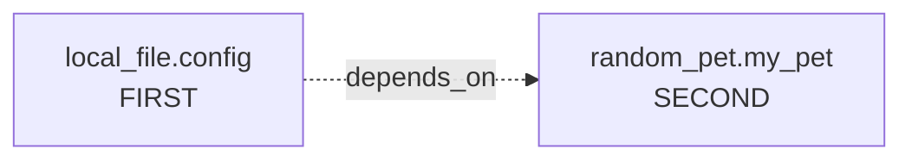

### Order rules

```
 CREATE   : dependency  ──▶  dependent
 DESTROY  : dependent   ──▶  dependency      (reverse)
 NO LINK  : created in parallel
```

### Dependency graph (many resources)

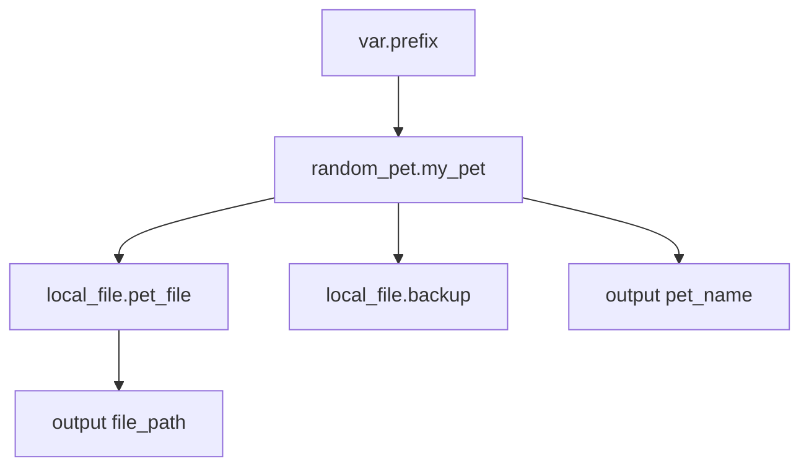

`F1` and `F2` do not depend on each other, so Terraform creates them **in parallel**.

```bash
terraform graph        # prints the graph in DOT format (paste into a Graphviz viewer)
```

---

## 2. Output variables

An **output** exposes a value after `apply`. Use it to print results, query them later, or pass values out of a module.

```hcl
output "pet_name" {
  value       = random_pet.my_pet.id
  description = "The generated pet name"
}

output "file_path" {
  value = local_file.pet_file.filename
}

output "secret" {
  value     = "hidden"
  sensitive = true        # shown as <sensitive> in the terminal
}
```

After `apply`:

```
Outputs:

file_path = "./pets.txt"
pet_name  = "happy-otter"
secret    = <sensitive>
```

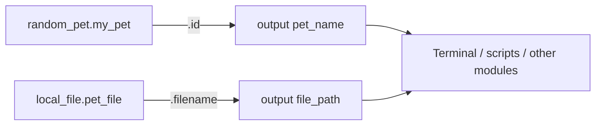

### Commands

```bash
terraform output                 # all outputs
terraform output pet_name        # one output
terraform output -raw pet_name   # plain value, no quotes (scripts)
terraform output -json           # JSON
```

Outputs are saved in **state**, so `terraform output` works without re-applying.

### Output arguments

| Argument | Meaning |
|---|---|
| `value` | Expression to expose (required) |
| `description` | Explains the output |
| `sensitive` | Hides the value in the terminal (still plain text in state) |
| `depends_on` | Rarely needed |

### Outputs can be any type

```hcl
output "summary" {
  value = {
    name = random_pet.my_pet.id
    file = local_file.pet_file.filename
  }
}
```

---

## 3. Terraform state (deep dive)

**State** (`terraform.tfstate`) is Terraform's record of what it created. It maps each resource in code to the real thing.

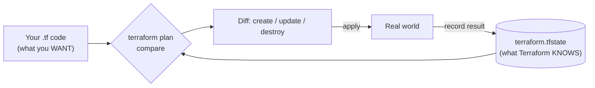

### Why it exists

| Purpose | Explanation |
|---|---|
| Mapping | Links `local_file.pet_file` to the actual file |
| Change detection | Compares code vs state |
| Dependencies | Remembers order for destroy |
| Random values | `random_pet` name is stored so it does **not** change each apply |
| Performance | Avoids re-reading everything |

```
 CODE          STATE           RESULT
 ─────────     ─────────       ─────────────
 resource      (missing)   ──▶ create
 resource      matches     ──▶ nothing
 resource      differs     ──▶ update
 (removed)     exists      ──▶ destroy
```

### State commands

```bash
terraform show                                  # readable state
terraform state list                            # tracked resources
terraform state show random_pet.my_pet          # one resource in detail
terraform state mv random_pet.old random_pet.new   # rename WITHOUT recreating
terraform state rm local_file.pet_file          # stop tracking (real thing NOT deleted)
terraform state pull                            # print raw state JSON
terraform apply -replace="random_pet.my_pet"    # force recreate one resource
terraform apply -refresh-only                   # sync state with reality
terraform import <TYPE>.<NAME> <ID>             # adopt an existing resource
```

### Drift

**Drift** = reality changed outside Terraform (someone edited the file by hand).

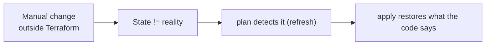

Try it:

```bash
terraform apply          # creates pets.txt
rm pets.txt              # manual change = drift
terraform plan           # shows: local_file.pet_file will be created
```

### Refactoring without destroying: `moved` block

Renaming a resource in code normally means destroy and create. A `moved` block tells Terraform it is the **same** resource.

```hcl
moved {
  from = random_pet.my_pet
  to   = random_pet.main_pet
}

resource "random_pet" "main_pet" {     # renamed
  length = 2
}
```

### Rules

- **Never edit** the state file by hand.
- **Never commit** it to Git (secrets are stored in plain text, even `sensitive` ones).
- **Don't delete** it. Terraform would forget everything and try to create it all again.
- `terraform.tfstate.backup` is the previous version, kept automatically.

---

## 4. Remote state and locking

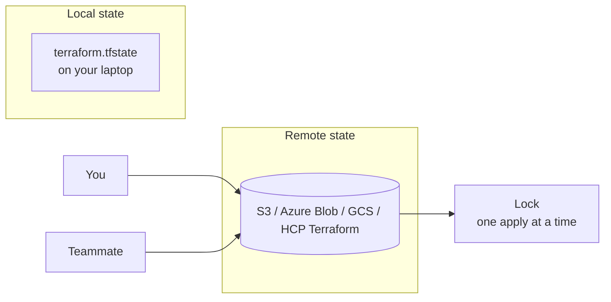

| | Local | Remote |
|---|---|---|
| Location | Your folder | Cloud storage |
| Team sharing | No | Yes |
| Locking | No | Yes (prevents two applies at once) |
| Encryption and versioning | No | Yes (provider dependent) |
| Best for | Learning | Teams, production |

```hcl
terraform {
  backend "s3" {
    bucket = "my-tf-state"
    key    = "project/terraform.tfstate"
    region = "us-east-1"
    # locking: dynamodb_table (older) or use_lockfile = true (newer versions)
  }
}
```

After adding or changing a backend, run:

```bash
terraform init            # offers to migrate existing state
```

### Read another project's outputs

```hcl
data "terraform_remote_state" "network" {
  backend = "s3"
  config = {
    bucket = "my-tf-state"
    key    = "network/terraform.tfstate"
    region = "us-east-1"
  }
}

# use: data.terraform_remote_state.network.outputs.<output_name>
```

```bash
terraform force-unlock <LOCK_ID>     # only if a crashed run left a stuck lock
```

---

## 5. Lifecycle rules

The `lifecycle` block changes **how Terraform creates, updates and destroys** one resource.

```hcl
resource "local_file" "pet_file" {
  filename = "${path.module}/pets.txt"
  content  = "My pet is ${random_pet.my_pet.id}"

  lifecycle {
    create_before_destroy = true
    prevent_destroy       = true
    ignore_changes        = [content]
    replace_triggered_by  = [random_pet.my_pet]
  }
}
```

| Rule | What it does | Use for |
|---|---|---|
| `create_before_destroy` | On replace, build the **new** one first, then delete the old | Avoiding downtime |
| `prevent_destroy` | Any plan that would destroy it **fails** | Protecting critical resources |
| `ignore_changes` | Ignore edits to listed arguments | Values changed by other tools |
| `replace_triggered_by` | Recreate this resource when another one changes | Linked resources |

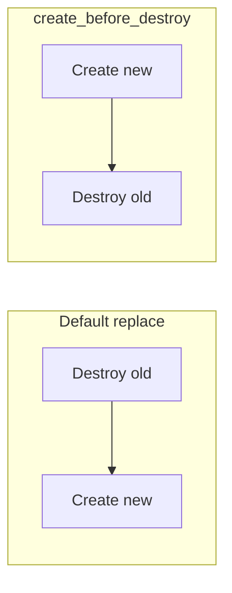

### Conditions: `precondition` and `postcondition`

Custom checks that stop the run with a clear message.

```hcl
resource "random_pet" "my_pet" {
  length = var.pet_length

  lifecycle {
    precondition {
      condition     = var.pet_length >= 2
      error_message = "pet_length must be at least 2."
    }
  }
}
```

### Resource states

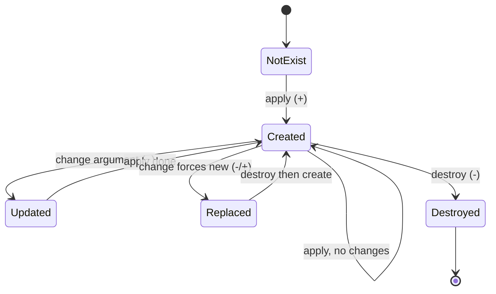

---

## 6. Expressions: conditionals, loops, functions

### Conditional

```
 condition ? value_if_true : value_if_false
```

```hcl
variable "environment" {
  type    = string
  default = "dev"
}

resource "random_pet" "my_pet" {
  length = var.environment == "prod" ? 3 : 2
}
```

**Create a resource only if a flag is true** (`count` as an on/off switch):

```hcl
variable "create_file" {
  type    = bool
  default = true
}

resource "local_file" "optional" {
  count    = var.create_file ? 1 : 0
  filename = "${path.module}/optional.txt"
  content  = "I exist only when create_file = true"
}
```

### `for` expressions

```hcl
variable "names" {
  type    = list(string)
  default = ["alice", "bob", "carol"]
}

locals {
  upper_names = [for n in var.names : upper(n)]                  # list
  no_bob      = [for n in var.names : n if n != "bob"]           # filter
  name_length = { for n in var.names : n => length(n) }          # map
}
```

```
 [ for  item  in  collection : transform  if  condition ]    ──▶ list
 { for  k, v  in  collection : key => value }                ──▶ map
```

### Splat (`[*]`): shortcut for "all items"

```hcl
output "all_pet_names" {
  value = random_pet.many[*].id      # needs count on random_pet.many
}
```

### `count` vs `for_each`

| | `count` | `for_each` |
|---|---|---|
| Input | Number | Set or map |
| Identify by | Index `[0]` | Key `["alice"]` |
| Loop value | `count.index` | `each.key`, `each.value` |
| Remove middle item | Re-indexes others (may recreate them) | Only that item is removed |

```hcl
resource "random_pet" "per_owner" {
  for_each = toset(var.names)
  prefix   = each.key
}

resource "local_file" "per_owner" {
  for_each = toset(var.names)
  filename = "${path.module}/${each.key}.txt"
  content  = "${each.key} owns ${random_pet.per_owner[each.key].id}"
}
```

### Common built-in functions

| Function | Example | Result |
|---|---|---|
| `upper` / `lower` | `upper("cat")` | `"CAT"` |
| `join` | `join("-", ["a","b"])` | `"a-b"` |
| `split` | `split(",", "a,b")` | `["a","b"]` |
| `format` | `format("%s-%d", "pet", 3)` | `"pet-3"` |
| `length` | `length(["a","b"])` | `2` |
| `lookup` | `lookup(var.tags, "team", "none")` | value or default |
| `merge` | `merge(map1, map2)` | one combined map |
| `toset` | `toset(["a","a"])` | `["a"]` |
| `keys` / `values` | `keys({a=1})` | `["a"]` |
| `file` | `file("note.txt")` | file text |
| `jsonencode` | `jsonencode({a=1})` | `"{\"a\":1}"` |
| `try` | `try(var.x.y, "fallback")` | fallback if error |

Test any expression interactively:

```bash
terraform console
> upper("cat")
"CAT"
> [for n in ["a","b"] : upper(n)]
[ "A", "B" ]
```

---

## 7. Modules

A **module** is a folder of `.tf` files you reuse like a function. Every Terraform folder is already a module (the **root module**).

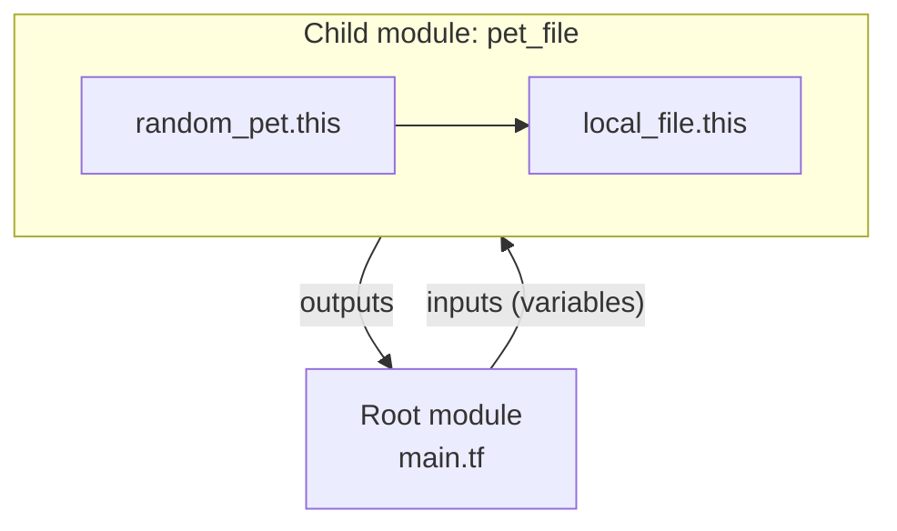

```
 terraform/
 ├── main.tf                    ← root module
 ├── outputs.tf
 └── modules/
     └── pet_file/              ← child module
         ├── main.tf
         ├── variables.tf
         └── outputs.tf
```

**`modules/pet_file/variables.tf`**

```hcl
variable "prefix"  { type = string }
variable "length"  {
  type    = number
  default = 2
}
variable "content" { type = string }
```

**`modules/pet_file/main.tf`**

```hcl
resource "random_pet" "this" {
  prefix = var.prefix
  length = var.length
}

resource "local_file" "this" {
  filename = "${path.root}/${random_pet.this.id}.txt"
  content  = var.content
}
```

**`modules/pet_file/outputs.tf`**

```hcl
output "pet_name" {
  value = random_pet.this.id
}
```

**Root `main.tf`** (calling the module)

```hcl
module "dev_pet" {
  source  = "./modules/pet_file"
  prefix  = "dev"
  content = "Hello from dev"
}

module "prod_pet" {
  source  = "./modules/pet_file"
  prefix  = "prod"
  length  = 3
  content = "Hello from prod"
}

output "dev_name"  { value = module.dev_pet.pet_name }
output "prod_name" { value = module.prod_pet.pet_name }
```

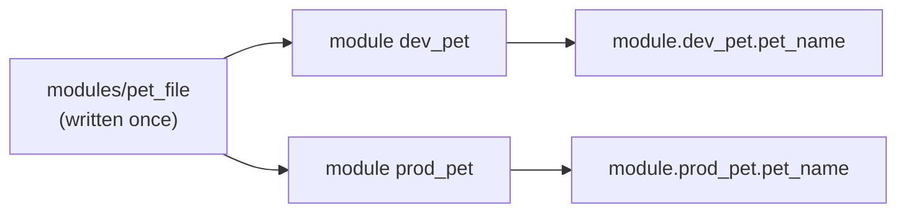

### Module rules

- Inputs = the module's `variable` blocks.
- Outputs = the **only** way to read values from inside a module: `module.<NAME>.<OUTPUT>`.
- After adding a module (or changing `source`), run `terraform init`.
- `source` can be a local path, a registry address, or a Git URL.
- Modules also support `count`, `for_each` and `depends_on`.

```hcl
module "pets" {
  source   = "./modules/pet_file"
  for_each = toset(["alice", "bob"])
  prefix   = each.key
  content  = "Hello ${each.key}"
}
# reference: module.pets["alice"].pet_name
```

---

## 8. Workspaces

A **workspace** gives the same code a **separate state**. Useful for dev / staging / prod copies.

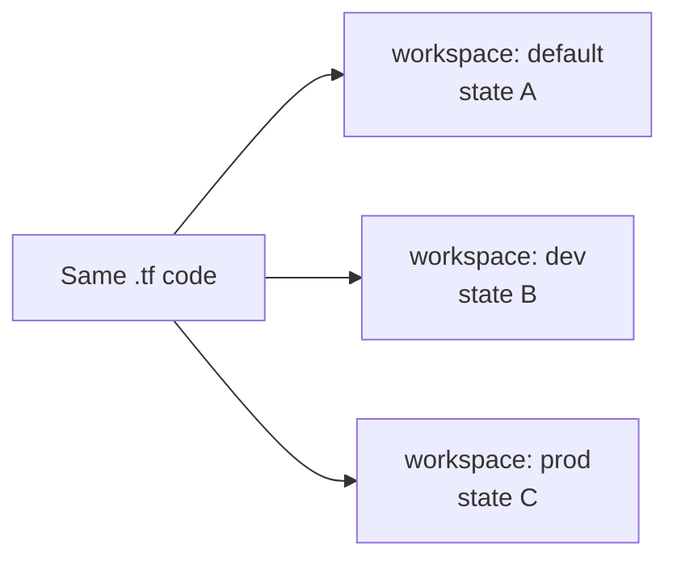

```bash
terraform workspace list
terraform workspace new dev
terraform workspace select dev
terraform workspace show
terraform workspace delete dev
```

Use the current name in code:

```hcl
resource "local_file" "env_file" {
  filename = "${path.module}/${terraform.workspace}-pets.txt"
  content  = "Environment: ${terraform.workspace}"
}
```

Locally, each workspace state lives in `terraform.tfstate.d/<name>/`.

> Workspaces share the same code and backend. Many teams prefer **separate folders or tfvars files per environment** for production.

---

## 9. Provisioners and `terraform_data`

A **provisioner** runs a command when a resource is created or destroyed. HashiCorp calls it a **last resort**, because Terraform cannot track what the command did.

`terraform_data` is a built-in resource (no provider to download) that is handy for running such steps:

```hcl
resource "terraform_data" "notify" {
  triggers_replace = [random_pet.my_pet.id]    # re-run when the pet changes

  provisioner "local-exec" {
    command = "echo Created pet ${random_pet.my_pet.id}"
  }
}
```

| Provisioner | Runs |
|---|---|
| `local-exec` | On your machine |
| `remote-exec` | On a remote server |

Prefer native resources, `user_data`, or configuration tools where possible.

---

## 10. Debugging and useful tools

| Tool | Command |
|---|---|
| Format code | `terraform fmt -recursive` |
| Check syntax | `terraform validate` |
| Try expressions | `terraform console` |
| Detailed logs | `export TF_LOG=DEBUG` (`TRACE`, `INFO`, `WARN`, `ERROR`) |
| Log to file | `export TF_LOG_PATH=tf.log` |
| Plan one resource | `terraform plan -target=random_pet.my_pet` |
| Save and apply a plan | `terraform plan -out=tfplan` then `terraform apply tfplan` |
| Show a saved plan | `terraform show tfplan` |
| Upgrade providers | `terraform init -upgrade` |

`-target` is for emergencies only. Normal runs should plan everything.

### Common errors

| Error | Cause and fix |
|---|---|
| `Reference to undeclared input variable` | `var.x` used but no `variable "x"` block |
| `Inappropriate value for attribute` | Wrong type (e.g. list given where string needed) |
| `Cycle` | Two resources depend on each other, so remove one reference |
| `Error acquiring the state lock` | Another run is active, or a stuck lock (`force-unlock`) |
| `Module not installed` | Run `terraform init` |
| `Invalid count argument` | `count` depends on a value unknown until apply |

---

## 11. Best practices

- Use **references**, not `depends_on`, whenever possible.
- Always set `type` and `description` on variables.
- Keep **secrets out of code and Git**. Use `sensitive`, environment variables, or a secrets manager.
- Use **remote state with locking** for teams.
- Commit `.terraform.lock.hcl`. Never commit `terraform.tfstate`, `.terraform/`, or secret `.tfvars`.
- Pin provider versions (`version = "~> 3.6"`).
- Always read the **plan** before `apply`.
- Prefer `for_each` over `count` for named items.
- Put repeated patterns into **modules**.
- Use `prevent_destroy` on critical resources.

---

## 12. Cheat sheet

```bash
terraform init                         # setup
terraform fmt                          # format
terraform validate                     # syntax check
terraform plan                         # preview
terraform apply                        # create / update
terraform destroy                      # delete all
terraform output                       # show outputs
terraform state list                   # tracked resources
terraform state show <addr>            # one resource
terraform state mv <old> <new>         # rename in state
terraform state rm <addr>              # untrack
terraform apply -replace="<addr>"      # force recreate
terraform apply -refresh-only          # sync state
terraform import <addr> <id>           # adopt existing
terraform workspace new <name>         # new workspace
terraform console                      # test expressions
terraform graph                        # dependency graph
```

| What | Reference syntax |
|---|---|
| Resource attribute | `random_pet.my_pet.id` |
| Data source | `data.local_file.x.content` |
| Variable | `var.name` |
| Local | `local.name` |
| Module output | `module.name.output` |
| `count` item | `random_pet.many[0].id` |
| `for_each` item | `random_pet.per_owner["bob"].id` |
| Workspace | `terraform.workspace` |
| Module folder | `path.module` |
| Root folder | `path.root` |

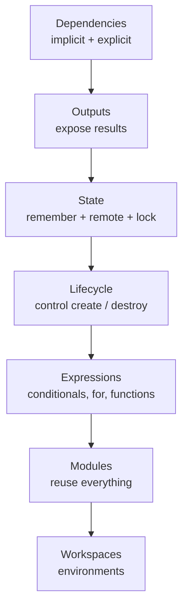