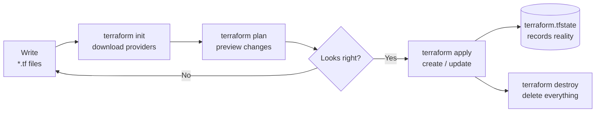
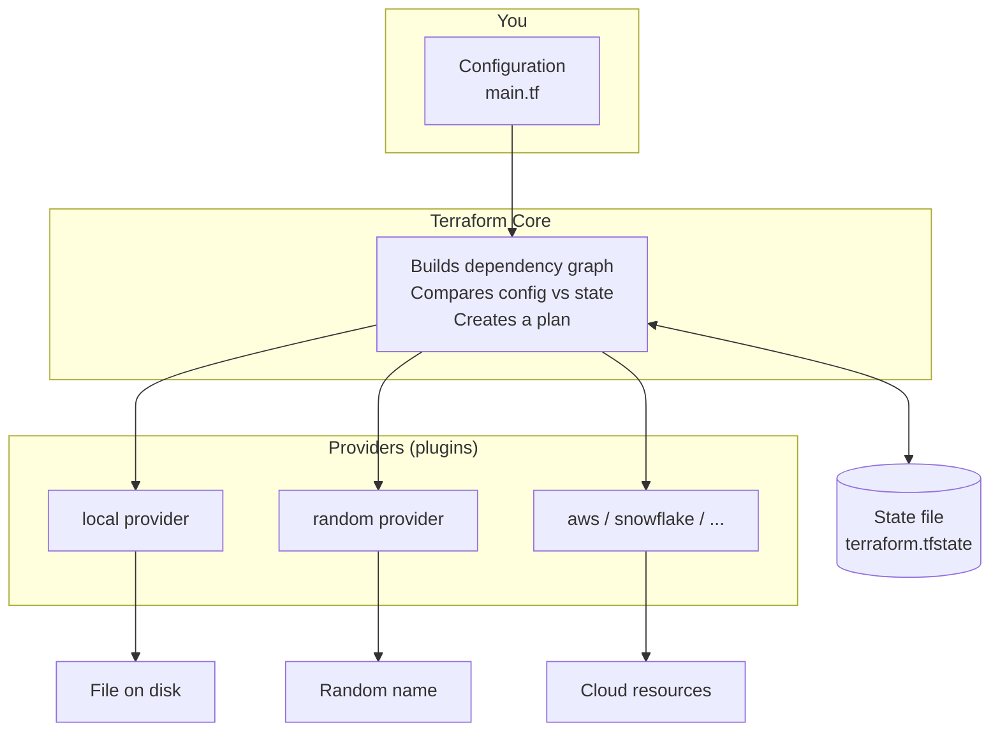
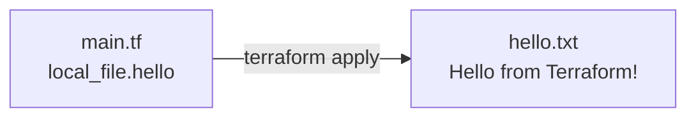
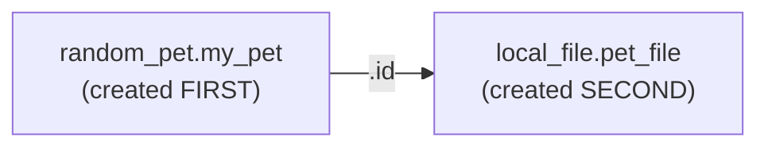
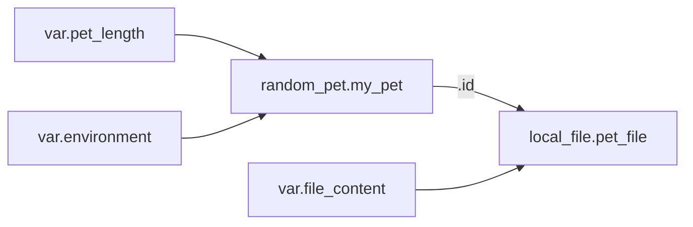
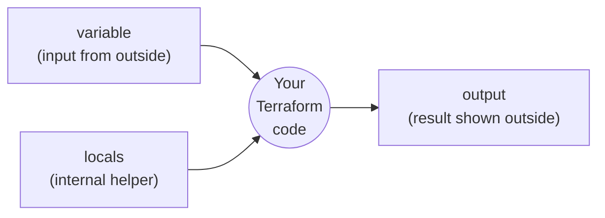
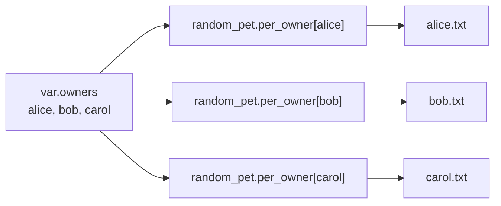
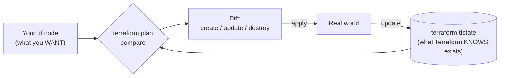
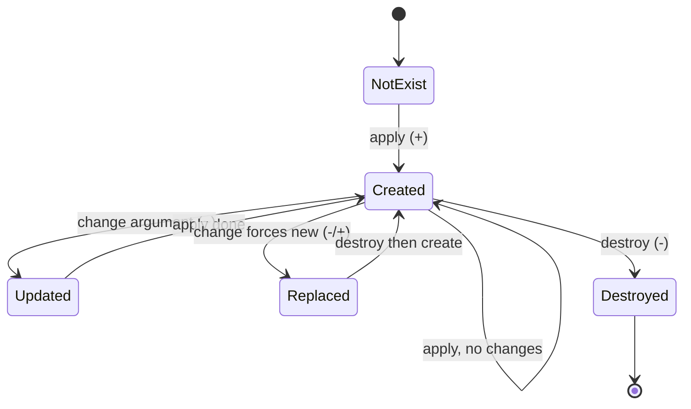
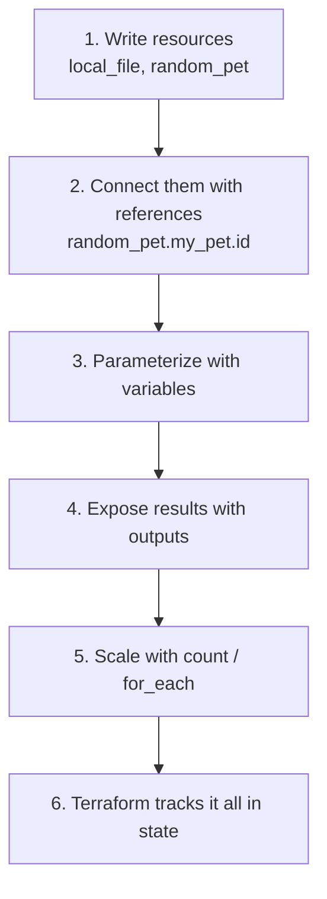

# Terraform Basics: Infrastructure as Code

Learn Terraform from zero using **two harmless providers** that need **no cloud account**:

| Provider | Resource | What it does |
|---|---|---|
| `hashicorp/local` | `local_file` | Creates a text file on your machine |
| `hashicorp/random` | `random_pet` | Generates a random pet name (e.g. `happy-otter`) |

Every concept here (resources, variables, state, dependencies) works the same way for AWS, Snowflake, GCP, etc. Only the provider and resource types change.

---

## Table of Contents

1. [What is Terraform?](#1-what-is-terraform)
2. [The Terraform workflow](#2-the-terraform-workflow)
3. [How Terraform works inside](#3-how-terraform-works-inside)
4. [Anatomy of a block](#4-anatomy-of-a-block)
5. [Step 1: Your first resource (`local_file`)](#5-step-1-your-first-resource-local_file)
6. [Step 2: Add `random_pet` and connect resources](#6-step-2-add-random_pet-and-connect-resources)
7. [Step 3: Variables](#7-step-3-variables)
8. [Step 4: Outputs and locals](#8-step-4-outputs-and-locals)
9. [Step 5: `count` and `for_each`](#9-step-5-count-and-for_each)
10. [Step 6: Data sources](#10-step-6-data-sources)
11. [State file](#11-state-file)
12. [Lifecycle of a resource](#12-lifecycle-of-a-resource)
13. [Recommended file layout](#13-recommended-file-layout)
14. [Command cheat sheet](#14-command-cheat-sheet)
15. [Common mistakes](#15-common-mistakes)

---

## 1. What is Terraform?

Terraform is an **Infrastructure as Code (IaC)** tool. You **describe** what you want in `.tf` files (declarative), and Terraform figures out **how** to create it.

```
 You write                Terraform reads           Terraform makes
 ┌──────────┐            ┌──────────────┐          ┌─────────────────┐
 │  main.tf │ ─────────▶ │  Terraform   │ ───────▶ │ Real resources  │
 │ (desired │            │  (compares   │          │ files, servers, │
 │  state)  │            │  with state) │          │ databases ...   │
 └──────────┘            └──────────────┘          └─────────────────┘
```

**Declarative vs imperative**

| Imperative (script) | Declarative (Terraform) |
|---|---|
| "Create a file, then write text" | "A file with this content should exist" |
| Running twice may create duplicates | Running twice changes nothing if nothing changed |

---

## 2. The Terraform workflow



| Command | Purpose |
|---|---|
| `terraform init` | Downloads providers into `.terraform/`, prepares the folder (run first, and after adding a provider) |
| `terraform fmt` | Auto-formats your code |
| `terraform validate` | Checks syntax and references |
| `terraform plan` | Shows what **would** change (changes nothing) |
| `terraform apply` | Makes the changes (asks `yes` to confirm) |
| `terraform destroy` | Deletes everything Terraform manages |

---

## 3. How Terraform works inside



**Key idea:** Terraform core does not know how to create a file or a server. **Providers** know that. Core only decides *what* needs to happen and *in what order*.

---

## 4. Anatomy of a block

Everything in Terraform is a **block**:

```hcl
resource "random_pet" "my_pet" {
  length    = 2
  separator = "-"
}
```

```
 resource   "random_pet"    "my_pet"     {  length = 2  }
    │            │             │              │
    │            │             │              └── arguments (settings, use "=")
    │            │             └── local name (YOUR label, used for references)
    │            └── resource type  (<provider>_<thing>)
    └── block type
```

**Reference it elsewhere with:** `<TYPE>.<LOCAL_NAME>.<ATTRIBUTE>`

```
 random_pet . my_pet . id
     │          │       └── attribute (value the resource exposes)
     │          └── local name
     └── resource type
```

**Common block types**

| Block | Labels | Purpose |
|---|---|---|
| `terraform` | 0 | Terraform and provider version settings |
| `provider` | 1 | Configure a provider |
| `resource` | 2 | Create something |
| `data` | 2 | Read something that already exists |
| `variable` | 1 | Input value |
| `locals` | 0 | Internal named values |
| `output` | 1 | Value shown after apply |
| `module` | 1 | Reuse a group of resources |

---

## 5. Step 1: Your first resource (`local_file`)

**`main.tf`**

```hcl
terraform {
  required_version = ">= 1.5.0"

  required_providers {
    local = {
      source  = "hashicorp/local"
      version = "~> 2.5"
    }
  }
}

resource "local_file" "hello" {
  filename = "${path.module}/hello.txt"
  content  = "Hello from Terraform!"
}
```

**What each part means**

| Line | Meaning |
|---|---|
| `required_providers` | Which plugin to download (`source = namespace/type`) |
| `version = "~> 2.5"` | Allow 2.5.x up to (not including) 3.0 |
| `resource "local_file" "hello"` | Create a `local_file` and call it `hello` |
| `filename` | Where to create the file |
| `content` | Text written inside the file |
| `path.module` | Built-in value: folder of the current `.tf` file |

**Run it**

```bash
terraform init      # downloads the "local" provider
terraform plan      # shows: + local_file.hello will be created
terraform apply     # type "yes" -> hello.txt appears
terraform destroy   # deletes hello.txt
```

**Reading the plan symbols**

| Symbol | Meaning |
|---|---|
| `+` | Will be **created** |
| `~` | Will be **updated in place** |
| `-` | Will be **destroyed** |
| `-/+` | Will be **destroyed and recreated** |



> **Try this:** change `content`, run `terraform plan` again. You will see `-/+` (`# forces replacement`), because the `local_file` provider cannot edit a file in place, so it deletes and recreates it. Run `apply` twice without changes and Terraform reports **"No changes"**. That is idempotency.

---

## 6. Step 2: Add `random_pet` and connect resources

`random_pet` generates a random name. We use it to name our file so each project gets a unique filename.

**`main.tf`**

```hcl
terraform {
  required_version = ">= 1.5.0"

  required_providers {
    local = {
      source  = "hashicorp/local"
      version = "~> 2.5"
    }
    random = {
      source  = "hashicorp/random"
      version = "~> 3.6"
    }
  }
}

resource "random_pet" "my_pet" {
  length    = 2      # number of words
  separator = "-"    # joins the words
  prefix    = "demo" # optional, put before the name
}

resource "local_file" "pet_file" {
  filename = "${path.module}/${random_pet.my_pet.id}.txt"
  content  = "My pet is called ${random_pet.my_pet.id}"
}
```

**Result:** a file named like `demo-happy-otter.txt` containing `My pet is called demo-happy-otter`.

### Implicit dependencies (the most important idea)

`local_file.pet_file` uses `random_pet.my_pet.id`. Terraform sees this reference and automatically knows the order.



```
 random_pet.my_pet ──── id = "demo-happy-otter" ────▶ local_file.pet_file
      step 1                                               step 2
 (no dependencies)                              (waits for the pet name)
```

- Resources with **no dependency** between them are created **in parallel**.
- Destroy runs in **reverse order** (file first, then pet).

### Explicit dependency (`depends_on`)

Use only when there is a hidden dependency Terraform cannot see from references.

```hcl
resource "local_file" "second" {
  filename   = "${path.module}/second.txt"
  content    = "created after pet_file"
  depends_on = [local_file.pet_file]
}
```

### Useful `random_pet` arguments and attributes

| Name | Kind | Meaning |
|---|---|---|
| `length` | argument | Number of words (default 2) |
| `separator` | argument | Character between words (default `-`) |
| `prefix` | argument | Text placed before the name |
| `keepers` | argument | Map; when a value changes, a **new** name is generated |
| `id` | attribute | The generated name |

> The random value is generated **once** and stored in state. It does **not** change on every `apply`.

---

## 7. Step 3: Variables

Variables make code reusable. Put them in **`variables.tf`**.

```hcl
variable "pet_length" {
  type        = number
  default     = 2
  description = "How many words in the pet name"
}

variable "file_content" {
  type        = string
  description = "Text to write inside the file"
  # no default, so Terraform will ask for it
}

variable "environment" {
  type    = string
  default = "dev"

  validation {
    condition     = contains(["dev", "prod"], var.environment)
    error_message = "environment must be dev or prod."
  }
}
```

**Use them with `var.<name>`**

```hcl
resource "random_pet" "my_pet" {
  length = var.pet_length
  prefix = var.environment
}

resource "local_file" "pet_file" {
  filename = "${path.module}/${random_pet.my_pet.id}.txt"
  content  = var.file_content
}
```



### Ways to set a value (lowest to highest priority)

```
 LOWEST                                                              HIGHEST
   │                                                                    │
   ▼                                                                    ▼
 default ─▶ TF_VAR_name ─▶ terraform.tfvars ─▶ *.auto.tfvars ─▶ -var-file ─▶ -var
```

| Method | Example |
|---|---|
| `default` in block | `default = 2` |
| Environment variable | `export TF_VAR_environment=prod` |
| `terraform.tfvars` | `environment = "prod"` |
| CLI file | `terraform apply -var-file="prod.tfvars"` |
| CLI flag | `terraform apply -var="pet_length=3"` |

**`terraform.tfvars`** (only assignments, no `variable` keyword)

```hcl
pet_length   = 3
environment  = "prod"
file_content = "Hello from tfvars"
```

### Variable types

| Type | Example value |
|---|---|
| `string` | `"hello"` |
| `number` | `42` |
| `bool` | `true` |
| `list(string)` | `["a", "b"]` |
| `set(string)` | `["a", "b"]` (unique, unordered) |
| `map(string)` | `{ team = "data" }` |
| `object({...})` | `{ name = "x", size = 10 }` |

---

## 8. Step 4: Outputs and locals

### Locals: named values used inside your code

```hcl
locals {
  file_name = "${var.environment}-${random_pet.my_pet.id}.txt"
  greeting  = "Hello ${random_pet.my_pet.id}, welcome to ${var.environment}"
}

resource "local_file" "pet_file" {
  filename = "${path.module}/${local.file_name}"
  content  = local.greeting
}
```

Use `local.<name>` (singular `local`, not `locals`).

### Outputs: values printed after `apply`

**`outputs.tf`**

```hcl
output "pet_name" {
  value       = random_pet.my_pet.id
  description = "The generated pet name"
}

output "file_path" {
  value = local_file.pet_file.filename
}

output "secret_note" {
  value     = "hidden value"
  sensitive = true   # shown as <sensitive> in the terminal
}
```

```bash
terraform output               # show all outputs
terraform output pet_name      # show one
terraform output -json         # machine-readable
```

### Variable vs local vs output



| Block | Direction | Can user set it? |
|---|---|---|
| `variable` | In | Yes |
| `locals` | Inside | No |
| `output` | Out | No (read only) |

---

## 9. Step 5: `count` and `for_each`

Create **many** copies of a resource from one block. Use one or the other, never both on the same resource.

### `count` (index based)

```hcl
resource "random_pet" "many" {
  count  = 3
  length = 2
}

resource "local_file" "many_files" {
  count    = 3
  filename = "${path.module}/pet-${count.index}.txt"
  content  = "Pet ${count.index} is ${random_pet.many[count.index].id}"
}
```

```
 random_pet.many[0] ──▶ local_file.many_files[0]  ──▶ pet-0.txt
 random_pet.many[1] ──▶ local_file.many_files[1]  ──▶ pet-1.txt
 random_pet.many[2] ──▶ local_file.many_files[2]  ──▶ pet-2.txt
```

Reference: `random_pet.many[0].id` or all at once `random_pet.many[*].id`.

### `for_each` (key based, usually better)

```hcl
variable "owners" {
  type    = set(string)
  default = ["alice", "bob", "carol"]
}

resource "random_pet" "per_owner" {
  for_each = var.owners
  prefix   = each.key
}

resource "local_file" "per_owner" {
  for_each = var.owners
  filename = "${path.module}/${each.key}.txt"
  content  = "${each.key} owns ${random_pet.per_owner[each.key].id}"
}
```



| | `count` | `for_each` |
|---|---|---|
| Input | A number | A set or map |
| Identify by | Index `[0]` | Key `["alice"]` |
| Loop variable | `count.index` | `each.key`, `each.value` |
| Removing an item in the middle | Re-indexes the rest (can recreate them) | Only that item is removed |
| Best for | N identical copies | Distinct named items |

---

## 10. Step 6: Data sources

A **data source** reads something that **already exists**. It never creates anything.

```hcl
# Read the file we created earlier
data "local_file" "existing" {
  filename = local_file.pet_file.filename
}

output "file_content_read_back" {
  value = data.local_file.existing.content
}
```

| | `resource` | `data` |
|---|---|---|
| Creates things | Yes | No |
| Reference syntax | `TYPE.NAME.attr` | `data.TYPE.NAME.attr` |
| Use for | Things Terraform manages | Things that exist already |

---

## 11. State file

After `apply`, Terraform writes **`terraform.tfstate`**, a JSON file mapping your code to real resources.



```
 CODE          STATE           RESULT
 ─────────     ─────────       ─────────────
 resource      (missing)   ──▶ create it
 resource      matches     ──▶ do nothing
 resource      differs     ──▶ update it
 (removed)     exists      ──▶ destroy it
```

**Useful state commands**

```bash
terraform state list                      # all tracked resources
terraform state show random_pet.my_pet    # details of one
terraform show                            # whole state, readable
```

**Rules**

- **Never edit** `terraform.tfstate` by hand.
- **Never commit** it to Git (it can contain secrets). Add to `.gitignore`.
- In teams, use a **remote backend** (S3, Terraform Cloud, etc.) so everyone shares one state.

---

## 12. Lifecycle of a resource



**Lifecycle meta-argument**

```hcl
resource "local_file" "protected" {
  filename = "${path.module}/important.txt"
  content  = "do not delete"

  lifecycle {
    prevent_destroy       = true          # error if a plan would destroy it
    create_before_destroy = true          # create the new one first on replace
    ignore_changes        = [content]     # ignore edits to this argument
  }
}
```

---

## 13. Recommended file layout

```
terraform/
├── README.md            ← this file (GitHub shows it for the folder)
├── main.tf              ← resources
├── variables.tf         ← variable declarations
├── outputs.tf           ← outputs
├── versions.tf          ← terraform {} block, provider versions
├── terraform.tfvars     ← your variable values
├── .terraform.lock.hcl  ← provider versions locked (COMMIT this)
├── .terraform/          ← downloaded plugins  (do NOT commit)
├── terraform.tfstate    ← state               (do NOT commit)
└── .gitignore
```

Terraform loads **all `*.tf` files in the folder together**. File names are only for humans.

**`.gitignore`**

```gitignore
.terraform/
*.tfstate
*.tfstate.*
crash.log
*.tfvars        # if it contains secrets
```

---

## 14. Command cheat sheet

```bash
terraform init                      # setup, download providers
terraform fmt                       # format code
terraform validate                  # check syntax
terraform plan                      # preview
terraform plan -out=tfplan          # save the plan
terraform apply                     # apply (asks yes)
terraform apply -auto-approve       # apply without asking
terraform apply tfplan              # apply a saved plan
terraform destroy                   # delete everything
terraform output                    # show outputs
terraform state list                # tracked resources
terraform apply -replace="random_pet.my_pet"   # force new pet name
```

### Reference syntax table

| What | Syntax |
|---|---|
| Resource attribute | `random_pet.my_pet.id` |
| Data source | `data.local_file.existing.content` |
| Variable | `var.pet_length` |
| Local | `local.file_name` |
| Module output | `module.name.output` |
| `count` item | `random_pet.many[0].id` |
| `for_each` item | `random_pet.per_owner["bob"].id` |
| Interpolation | `"hello-${var.name}"` |
| Current folder | `path.module` |

---

## 15. Common mistakes

| Mistake | Fix |
|---|---|
| Forgot `terraform init` | Run it first (and after adding providers) |
| Using `=` on a nested block | Nested blocks have no `=`, arguments do |
| `locals.name` | Correct form is `local.name` |
| Using `count` and `for_each` together | Pick one |
| Committing `terraform.tfstate` | Add to `.gitignore` |
| Expecting `random_pet` to change every apply | It is stored in state; use `-replace` or `keepers` |
| Editing the generated file by hand | Terraform will revert it on next `apply` (drift) |

---

## Quick recap

